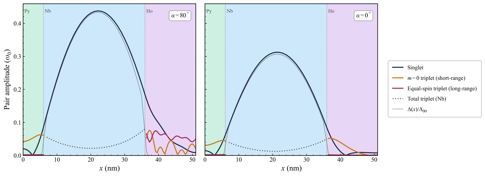
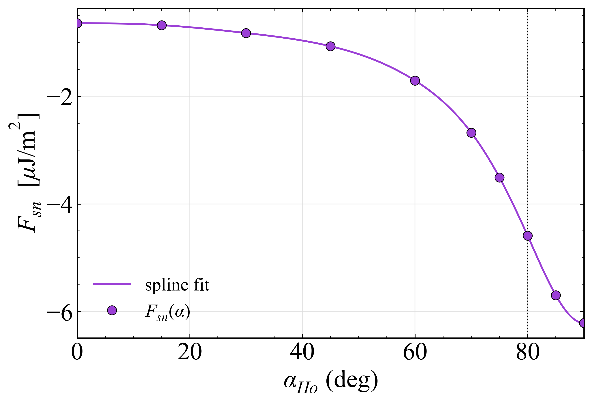

# Riccati-parametrised Usadel solver for Ho/Nb/Py trilayers

A Python solver for the superconducting proximity effect in a **Py / Nb / Ho** trilayer, written for my MPhil thesis *Probing Damping and Anisotropy Signatures of Triplet Cooper Pairs with Ferromagnetic Resonance and SQUID in Ho/Nb/Py Trilayers* (Zak Trivedi, University of Cambridge, 2026; supervised by Prof. Chiara Ciccarelli).

It answers one question: **when niobium becomes superconducting next to holmium's spiral magnetism, how does the superconducting energy depend on the shape of that spiral?** The answer helps explain anisotropy shifts measured with ferromagnetic resonance (FMR) in the same samples.



---

## Background in brief

- **Cooper pairs and magnets don't mix well.** Ordinary superconductors such as Nb carry current as *spin-singlet* pairs (one spin up, one spin down). A ferromagnet's exchange field pulls the two spins apart, so singlets die out within a few nanometres of entering a magnet.
- **Equal-spin triplets survive.** Pairs with both spins parallel (↑↑ or ↓↓) are not broken by the exchange field and can carry spin over long distances. They are the key ingredient for *superconducting spintronics*: low-dissipation spin transport for cryogenic memory and quantum hardware.
- **Making triplets requires a non-collinear magnet.** A singlet first *mixes* into an m = 0 triplet at a magnetic interface, then must be *rotated* into ↑↑/↓↓ by a magnetisation that changes direction.
- **Holmium supplies that rotation in a single layer.** Below ~20 K, Ho is a *conical* ferromagnet: its moments spiral around the film normal at a cone angle α, with a period of a few nanometres.
- **Why energy matters.** Producing triplets drains singlets from the condensate, which costs free energy. The superconductor therefore "prefers" some magnetic configurations over others, and exerts an effective anisotropy field on the magnets. This field is what FMR can detect.

This code computes the pair correlations throughout the stack, and the superconducting free energy as a function of the Ho cone angle α.

---

## Model

### Structure

The default parameters reproduce the thesis sample, with lengths in units of ξ₀ = 10 nm:

| Layer | Thickness | Exchange field **h** |
|---|---|---|
| Py | 6 nm | uniform, in plane (ẑ) |
| Nb | 30 nm | 0 (superconducting) |
| Ho | 15 nm | conical spiral (below) |

The Ho texture uses the cone axis along the film normal x̂, the opening angle α measured from that axis, and the spiral wavelength λ = 6.3 nm:

$$
\mathbf{h}(x) = h_{\rm Ho}\big[\cos\alpha\,\hat{\mathbf x} + \sin\alpha\,(\cos Qx\,\hat{\mathbf y} + \sin Qx\,\hat{\mathbf z})\big],\qquad Q = 2\pi/\lambda .
$$

- At α = 0° the magnetisation points straight out of plane, with no spiral.
- At α = 80° (bulk Ho) the magnetisation is a strongly rotating helix.

### Usadel equation (diffusive limit, Matsubara form)

Sputtered films are disordered, so the quasiclassical Green's function ĝ obeys the Usadel equation. It is written in the 4×4 Nambu ⊗ spin space and evaluated at Matsubara frequencies ωₙ = πk_BT(2n+1):

$$
\hbar D\,\partial_x(\hat g\,\partial_x\hat g) = \big[\hat\Lambda,\hat g\big],\qquad
\hat\Lambda = \omega_n\hat\tau_3 + i\hat V + \hat\Delta ,
$$

$$
\hat V=\begin{pmatrix}\mathbf h\cdot\boldsymbol\sigma & 0\\ 0 & (\mathbf h\cdot\boldsymbol\sigma)^*\end{pmatrix},\qquad
\hat\Delta=\begin{pmatrix}0 & \Delta\, i\sigma_y\\ -\Delta\, i\sigma_y & 0\end{pmatrix}.
$$

### Riccati parametrisation

The code writes ĝ in terms of two 2×2 matrices γ and γ̃. This form automatically satisfies the normalisation ĝ² = 1, which keeps the numerics stable:

$$
\hat g=\begin{pmatrix}N(1+\gamma\tilde\gamma) & 2N\gamma\\ -2\tilde N\tilde\gamma & -\tilde N(1+\tilde\gamma\gamma)\end{pmatrix},\qquad N=(1-\gamma\tilde\gamma)^{-1},\ \tilde N=(1-\tilde\gamma\gamma)^{-1}.
$$

The solver integrates the two coupled equations below.

$$
\hbar D\big[\gamma'' + 2\gamma'\tilde N\tilde\gamma\gamma'\big] = 2\omega_n\gamma + i\big(\mathbf h\cdot\boldsymbol\sigma\,\gamma - \gamma\,\mathbf h\cdot\boldsymbol\sigma^*\big) - \Delta\, i\sigma_y - \Delta\,\gamma\, i\sigma_y\,\gamma
$$

$$
\hbar D\big[\tilde\gamma'' + 2\tilde\gamma' N\gamma\tilde\gamma'\big] = 2\omega_n\tilde\gamma + i\big(\tilde\gamma\,\mathbf h\cdot\boldsymbol\sigma - \mathbf h\cdot\boldsymbol\sigma^*\,\tilde\gamma\big) - \Delta\, i\sigma_y - \Delta\,\tilde\gamma\, i\sigma_y\,\tilde\gamma
$$

For a non-collinear field there is no pointwise relation between γ and γ̃, so the solver evolves both.

The pair amplitude f = 2Nγ splits into singlet and triplet parts:

$$
f = (f_0 + \mathbf f_t\cdot\boldsymbol\sigma)\, i\sigma_y .
$$

Inside each magnet, the triplet vector **f**_t is projected onto the *local* field direction:
- the component **parallel** to **h** is the short-range m = 0 triplet;
- the component **perpendicular** to **h** is the long-range equal-spin triplet.

### Self-consistent gap

The gap Δ(x) in Nb is suppressed near the magnets, so it is iterated to self-consistency with the gap equation below. Convergence is accelerated with Anderson mixing.

$$
\Delta(x)\ln\frac{T}{T_c} = 2\pi k_BT\sum_{n\ge0}\left[f_0(x,\omega_n) - \frac{\Delta(x)}{\omega_n}\right]
$$

### Free energy

The superconducting condensation energy per unit area uses the quasiclassical functional of Virtanen, Vargunin and Silaev:

$$
\frac{F_{sn}}{N_0} = \int dx\left\{\frac{|\Delta|^2}{\lambda} - \frac{\pi T}{2}\sum_{\omega_n}{\rm tr}\Big[(\omega_n + i\,\mathbf h\cdot\boldsymbol\sigma)\hat\tau_3\,\hat g + \hat\Delta\hat g - \frac{\hbar D}{4}(\partial_x\hat g)^2\Big]\right\}
$$

The pairing constant λ is eliminated with the cutoff-consistent BCS identity:

$$
\frac{1}{\lambda} = \ln\frac{T}{T_c} + 2\pi k_BT\sum_{n=0}^{N_c-1}\frac{1}{\omega_n}.
$$

The self-consistent solution is a *saddle point* of this functional. Numerical errors therefore enter F only at second order, which makes small energy differences between magnetic configurations resolvable.

---

## Numerical method

- **Boundary-value problem.** The whole stack is solved as one problem with `scipy.integrate.solve_bvp` at each Matsubara frequency.
- **Boundary conditions.**
  - At the outer surfaces, ∂ₓγ = ∂ₓγ̃ = 0 (vacuum).
  - The inner interfaces are fully transparent: γ, γ̃ and their derivatives are continuous.
- **Smoothed interfaces.** Material coefficients switch between layers over a narrow tanh window. This keeps the collocation problem well posed, and free-energy differences were checked to be insensitive to the window width.
- **Mesh.** Points are placed densely enough to resolve each Ho spiral period.
- **Matsubara sum.** It is truncated at N_c frequencies. The remaining power-law tail of the free energy is fitted and added analytically, so the slope dF/dα changes by less than 0.1 % between 24 and 36 frequencies.
- **Units.**
  - Code units: energies in Δ₀₀ (the T = 0 bulk Nb gap), lengths in ξ₀ = √(ħD/Δ₀₀), and temperature as t = T/T_c.
  - SI conversion uses N₀Δ₀₀² = H_c(0)²/μ₀, taking ξ₀ ≈ 10 nm and μ₀H_c(0) ≈ 0.2 T for Nb. These two values set only the absolute energy scale, not the shape of F(α).

Full derivations, sign conventions and literature cross-checks are in **[`solver_methods.pdf`](solver_methods.pdf)**.

---

## Repository contents

| File | Purpose |
|---|---|
| `usadel_free_energy.py` | Core solver: stack definition, Riccati Usadel equations, self-consistent gap, pair-amplitude decomposition, free-energy functional |
| `run_anisotropy.py` | Sweeps the Ho cone angle α, saves `results.csv` and per-angle `profiles_aXXX.npz`, and produces F(α) plots and an anisotropy summary (`summary.json`) |
| `plot_components.py` | Plots singlet, m = 0 and equal-spin triplet amplitudes across the stack (α = 80° vs 0°) |
| `solver_methods.pdf` | Methods document: every equation, its source and implementation notes |
| `*.png` | Thesis figures produced by the scripts |

## Usage

Requires Python 3 with `numpy`, `scipy` and `matplotlib`.

```bash
pip install numpy scipy matplotlib

python run_anisotropy.py           # full α sweep + analysis and plots
python run_anisotropy.py 0 5       # run only α-list entries 0–4 (long sweeps can be split)
python run_anisotropy.py analyse   # re-analyse existing results.csv
python plot_components.py          # pair-amplitude figure (needs the .npz profiles)
```

- **Physical parameters** (thicknesses, exchange fields, temperature, spiral wavelength) are in `PHYS` at the top of `run_anisotropy.py`.
- **Numerical settings** are in `NUM`. A looser preset for quick runs is noted in the comments there.
- **Running time.** Each cone angle is a full self-consistent solve, so a complete sweep can take a while.

---

## Key results

### Simulation

1. **Ho's cone generates long-range triplets.**
   - At α = 80°, the rotating Ho magnetisation produces equal-spin triplet amplitude inside Ho through spin mixing and spin rotation.
   - Continuous rotation causes a *cascading* interconversion between the m = 0 and m = ±1 components.
   - At α = 0° (no spiral) no equal-spin component appears.
   - Py, with its uniform field, generates only m = 0 triplets.

   *(See the figure at the top.)*

2. **The free energy is lowest when the cone lies flat in the film plane.**
   - F_sn(α) falls monotonically from roughly −0.5 μJ/m² at α = 0° to roughly −6 μJ/m² at α ≈ 90°.
   - This is counter-intuitive, because more triplets are produced at large α.
   - The reason is that the energy is dominated by *singlet pair-breaking* from Ho's out-of-plane exchange component. That component is strongest at small α and suppresses the gap far more than triplet conversion does.

   

### Experimental context (from the thesis; data not in this repo)

- **Anisotropy shift below T_c.**
  - Only the 15 nm Ho sample grown at high temperature on MgO showed a clear shift, of about 4 mT.
  - That sample was also the only one in which SQUID detected Ho's conical ferromagnetic phase.
  - The 15 nm Ho sample grown at room temperature on quartz, and a 5 nm Ho sample on MgO, showed shifts below 1 mT and no conical phase.
- **Angle-resolved FMR.** The shift was traced to an in-plane unidirectional anisotropy term. Its change between 12 K and 4 K was (4.1 ± 0.4) mT, which matches the measured shift. This correlation with Ho's conical phase is consistent with equal-spin triplet generation.
- **Damping.** Gilbert damping below T_c could not be extracted reliably. Vortex-induced changes in inhomogeneous broadening dominated the linewidth.

---

## Assumptions and limitations

- **Diffusive limit.** Mean free path ≪ coherence length is assumed. A clean, epitaxial Nb film would need the full Eilenberger equation instead.
- **Weak-ferromagnet surrogate.** Ho and Py are modelled with exchange fields of a few Δ₀₀, following Linder *et al.* (PRB 79, 054523). Real Ho is a strong ferromagnet.
- **Interfaces.** These are perfectly transparent. Kupriyanov–Lukichev barriers would be a natural extension.
- **Normal-state parameters.** The density of states N₀ is uniform across layers, and all diffusion constants are equal by default (the code supports different values per layer).
- **Dimensionality.** The model is 1D: no vortices, domains or in-plane variation.

## Key references

- K. D. Usadel, *PRL* **25**, 507 (1970) — Usadel equation
- J. Linder, T. Yokoyama, A. Sudbø, *PRB* **79**, 054523 (2009) — conical-Ho proximity model
- N. Schopohl, K. Maki, *PRB* **52**, 490 (1995); S. H. Jacobsen, J. A. Ouassou, J. Linder, *PRB* **92**, 024510 (2015) — Riccati parametrisation
- P. Virtanen, A. Vargunin, M. Silaev, *PRB* **101**, 094507 (2020) — quasiclassical free energy
- L. G. Johnsen, N. Banerjee, J. Linder, *PRB* **99**, 134516 (2019) — superconductivity-induced magnetic anisotropy
- J. Linder, J. W. A. Robinson, *Nat. Phys.* **11**, 307 (2015) — superconducting spintronics review
